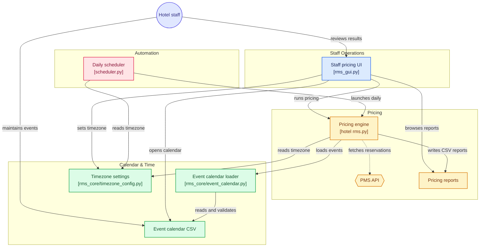

<p align="center"><a href="README.md">English</a> | <a href="README.zh-CN.md">简体中文</a></p>

# Hotel RMS（定价建议）

单酒店定价决策演示。按房型生成未来 90 天的建议房价，输入包括预订进度、入住率、提前天数、竞品价格，以及员工维护的节假日 / 活动日历。每次运行输出两份 CSV；另有一个独立的 Tkinter 界面用于查看结果和解释定价。

> 未配置 PMS 凭据时运行在 `DEMO` 模式：预订、竞品价、基准 ADR 均为合成数据；报告带 `Data_Mode` 列，界面常驻警告。此模式的房价仅供演示与评审，不得发布到售卖渠道。

`User_Guide.txt` 是英文操作员速查。英文 `README.md` 为原文，本文为对应的中文版；措辞有差异时以英文版为准。

## 文件

| 文件 | 用途 |
| --- | --- |
| `hotel rms.py` | 定价引擎：PMS 适配、90 天模型、CSV 导出 |
| `rms_gui.py` | Tkinter 界面：运行定价、查看结果、解释房价、打开日历 |
| `scheduler.py` | 常驻调度进程，每日 06:00 运行（`--run-now` 先跑一次再常驻） |
| `rms_core/` | 库模块包，被上面三个入口导入，从不直接运行（内容见下表） |
| `Public holidays.csv` | **员工维护**的节假日与活动，唯一的事件因子来源 |
| `Run_Pricing_Now.bat` | Windows：运行一次定价 |
| `Start_Pricing_UI.bat` | Windows：打开界面 |
| `User_Guide.txt` | 操作员速查（英文） |
| `HANDOVER.md` | 交接状态：已验证什么、哪些输入仍是合成数据、哪些是有意不做的 |
| `tests/` | 十份行为契约与 `run_all.py`：各自把项目复制到沙箱再断言行为，不是 pytest，也不依赖引擎以外的库 |
| `golden/` | 冻结的单次定价快照（`v7` 为当前基线，`v0` 为纠偏前参照）与只读比对工具 |
| `output/` | 运行期生成：两份报告、`rms_run.log`、`rms_scheduler.log` 与 `archive/`，已被 git 忽略 |

`rms_core/` 内部：

| 模块 | 用途 |
| --- | --- |
| `event_calendar.py` | 加载并校验事件日历 |
| `timezone_config.py` | 共享时区设置与 IANA 可用性检查 |
| `report_writer.py` | 原子发布报告：私有临时文件 + 一次 `os.replace` |
| `report_retention.py` | 将旧报告软删除归档到 `archive/` |
| `price_guard.py` | 发布前对定价结果做只读一致性检查 |

可运行入口只有 `hotel rms.py`、`rms_gui.py`、`scheduler.py`——只有这三个留在顶层，`.bat` 与调度进程才能继续按文件名找到它们。`rms_core/` 里的模块均由这些脚本导入，没有命令行接口；每个入口都会把所在目录加入 `sys.path`，因此从其他目录启动也能正常导入。`timezone_settings.json` 由界面选择时区时生成，已被 git 忽略；报告、日志、`__pycache__`、本地凭据同样被忽略。

## 系统架构

下图展示各脚本、员工维护的输入与生成的报告在运行时的依赖关系。实线为直接交互（启动、读写、维护），虚线为可选的 PMS 取数（`DEMO` 模式下短路为合成数据）。四个分组依次为员工操作、定价、日历与时区、自动化调度；节点文字保留生成时的英文，便于日后从仓库重新生成。



`hotel rms.py` 是中心：经 `event_calendar.py` 载入事件日历、读取共享时区设置、启用 PMS 客户端时拉取预订、写出两份 CSV。运行由界面或 `scheduler.py` 触发，两者也都读取同一份时区设置。真实 / 合成数据的区分见「数据来源」。

## 环境要求

Python 3.9+：

```bat
pip install pandas numpy requests schedule
```

`schedule` 只供 `scheduler.py` 使用。`tkinter` 随 Windows / macOS 版 CPython 提供，部分 Linux 发行版需单独安装（如 `python3-tk`）。两个 `.bat` 不直接调用 `python`，而是先启动 `rms_core/launcher.py`，由它逐个探测解释器（`py -3`、`py`、`python`、`python3`，最后是运行 launcher 的那个）并选用第一个真能导入三个依赖的。详见「为什么 `.bat` 不直接调用 `python`」。命名 IANA 时区需要系统时区数据库，Windows 上另装 `tzdata`；默认的 `Follow local system time` 无需额外依赖，也不需要 `pytz`。

## 快速开始

先 `cd` 到仓库目录，`.bat` 启动器会自动切换。报告始终写入 **`output/`** 文件夹，无论从哪个目录启动引擎。

```bat
Run_Pricing_Now.bat --check    # 自检：用哪个解释器、依赖是否就绪
Run_Pricing_Now.bat            # 运行一次，生成两份 CSV
Start_Pricing_UI.bat           # 打开界面，点 "Run Pricing Now"
python "hotel rms.py"          # 等价于上面的循环（自己用 Python 跑时）
python rms_gui.py              # 等价于上面的界面
python scheduler.py --run-now  # 先跑一次，然后常驻等待每日 06:00
```

### 为什么 `.bat` 不直接调用 `python`

`where python` 只能证明 PATH 上存在某个**名字**，不能证明它背后装了 `pandas`。一台机器装了多个 Python 时，PATH 里的 `python` 常常是没装依赖的那个，而 `py` 才指向完整的那个——本项目的开发机就是这种情况。此时双击 `Run_Pricing_Now.bat` 会在一个来不及看清的窗口里报 `ModuleNotFoundError` 然后消失。

因此两个启动器都改为调用 `rms_core/launcher.py`：它逐个**真实导入**三个依赖来探测候选解释器（`py -3`、`py`、`python`、`python3`，最后是运行 launcher 的那个），采用第一个成功的；会打印选中的解释器；如果一个都不可用，则列出所有尝试过的解释器、各自的失败原因，以及确切的 `pip install` 命令，并停住等待按键而不是一闪而过。

`--check` 只做检查、不启动任何东西。`RMS_NO_PAUSE=1` 可取消结尾的按键等待，便于无人值守调用。

`scheduler.py --run-now` 跑完不会退出：需保持窗口，按 `Ctrl+C` 结束。没有常驻进程就没有每日 06:00 的自动运行。

默认无 PMS 凭据时引擎走合成数据、不发网络请求，可完全离线运行。设置 `PMS_API_KEY` / `PMS_BASE_URL` 后会启用可选的 HTTP 客户端，此时需要网络。

## 界面可信性

`rms_gui.py` 只围绕一条原则：**屏幕上显示的东西，必须如实描述自己。** 四条行为保证这一点。

- **打开即加载上次的结果。** 员工通常在定时任务跑完之后才开窗口，所以表格、数据模式横幅和 `Data generated: <时间>` 都在启动时填好。空窗口会让人误以为工具从没跑过。
- **失败会说清楚，并说明原因。** `describe_engine_exit()` 把引擎退出码翻译成具体句子：`0` 成功、`2` 日历或配置值非法、`3` 价格护栏拒绝发布、其余为意外崩溃。失败时新鲜度标签变红（`STALE - last updated ...`），另有一条独立的红色提示 `RESULTS NOT UPDATED - showing data from ...`。数据模式横幅刻意用**另一个**标签——失败绝不能把 DEMO 警告覆盖掉。
- **保留上一份表格，但重新标注。** 清空行会抹掉上一次的建议、让员工无所适从；保留并显式标注「已过期」既保住了上下文，也不会伪装成本次运行成功。
- **运行可取消，关窗会停掉子进程。** `Cancel Run` 终止引擎进程（5 秒后升级为强制结束）并把界面恢复空闲。运行中关窗会要求确认并杀掉子进程，避免窗口关掉后仍有孤儿进程往报表目录里写数据。取消不等于失败：屏幕上的结果保持不动，也不会被标记为过期。

工作线程从不直接调用 Tk——那样会抛 `main thread is not in main loop`。所有跨线程工作都通过 `queue.Queue` 交给主线程消费，这也是运行中关窗不再打印 traceback 的原因。

## 节假日 / 活动日历

`Public holidays.csv` 是事件因子的唯一来源，引擎内没有硬编码事件。界面点 **Open Event Calendar** 打开，另存为 UTF-8 CSV，再点 **Run Pricing Now**；无需重启。

### 列

| 列 | 格式 | 含义 |
| --- | --- | --- |
| `Date` | `YYYY/MM/DD`，如 `2026/12/25` | 必须带四位年份。`Recurring=Y` 时只取月日，年份为占位符；否则只定价该日期一次 |
| `Event_Name` | 文本，可空 | 显示在报告中；为空时原因显示 `Public Holiday Demand Window Triggered` |
| `Event_Factor` | 有限数值且 > 0 | 需求乘数：`1.00` 不变，`1.25` 为 +25%，`0.90` 为 -10%。留空、`NaN` 或 `inf` 会中止运行，绝不当作「无事件」处理。常用区间 0.50–3.00，越界仍会载入并输出 `[WARN]`；超过 5.00 会额外标记为疑似录入错误 |
| `Category` | `Public Holiday` / `Special Event` / `School Holiday` / `Custom` | 用于定价原因；未知值映射为 `Special Event` 并告警 |
| `Recurring` | `Y` 或 `N`（空 = `N`） | `Y` 每年重复同一月日 |

`Holiday_Factor`、`Special_Event_Factor` 可作为 `Event_Factor` 的别名。旧版 `YYYY-MM-DD` 仍接受，裸 `MM-DD` **不接受**：旧日历若用了 `MM-DD`，需先改写日期。`#` 开头行与空行忽略。

### 规则

- 日期是绝对值：同一入住日期的事件因子不随运行日变化，不使用 `today + N` 偏移。
- `Recurring=Y` 只取月日，固定日期节假日自动延续到后续年份。
- 同一日期上，一次性行（`Recurring=N`）覆盖年度行，**不论先后顺序**；同类型行之间，文件中最后一行胜。用一次性行可覆盖某一年的节假日。
- 只定价当前 90 天窗口内的日期。窗口从所选物业时区的当日开始，跨日期线切换时区可能让窗口平移一天，属预期行为。
- 文件缺失、缺 `Date` / `Event_Factor` 列、日期非法、因子非数值 / 非有限 / ≤ 0：中止运行并给出行号，不静默回退到演示事件。
- 日历维护分两级检查，并且每次运行都会报出覆盖率，例如 `Calendar coverage: 5 of 90 stay dates carry an event factor (5.6%)`：
  - 某年完全没有事件行：告警提示该年度尚未维护。
  - 某年**只有**年度行（Recurring=Y）：告警提示该年没有任何一次性事件，移动节日（春节、复活节、赛事）会被当作普通日定价。年度占位行不再算作覆盖，这正是漏维护移动节日过去完全静默的原因。
- 同一日期被载入两次且因子不同时，仍然最后一行胜，但会输出告警并同时点出两行行号，避免无意的覆盖被当成正确价格。
- 只有日历错误会中止运行；PMS 时间戳或时区设置异常只输出 `[WARN]` 并回退默认值。

### 随附示例

文件带 5 行固定日期示例，全部 `Recurring=Y`：元旦、平安夜、圣诞节、圣诞周末、除夕，因子 1.20–1.50。它们只是示例，不是完整节假日表。按物业实际情况替换或增补；每年变动的日期用 `Recurring=N`，并每年依据当地官方日历刷新。演示不假定任何国家或物业。

**Excel 提示**：CSV 本身是纯 ASCII 英文文本。Excel 可能按系统区域设置重排日期单元格，例如中文环境下把 `2026/12/25` 显示为 `2026年12月25日`，但文件里并没有这些字符。编辑前把 `Date` 列设为文本，或改用 Notepad / VS Code；屏幕显示不影响引擎读取。

## 定价模型

```text
Base_Room_ADR     = BASELINE_ADR x RoomType_Factor
                    (Standard 135 x 1.00 = 135; Premium 160 x 1.25 = 200)
Recommended_ADR   = Base_Room_ADR x Weekend x Event_Factor x Occupancy
                         x Lead_Time x Booking_Pace x Competitor
Final_ADR         = clamp(floor(clamp(Recommended_ADR, MIN, MAX) + 0.5),
                          ceil(MIN), floor(MAX))
```

周末、入住率、进度、提前天数、竞品因子表，以及当日时间衰减和客流密度附加项，均定义在 `hotel rms.py`。本文中的「基准」一律指随附的 `BASELINE_ADR` 配置。

有三处细节和因子表同样决定最终价：

- **入住率只有一个定义。** `Current_Occupancy` 是引擎里唯一的入住率，`Effective_Occupancy` 现在按定义与它相同。分母已扣除维修封房；当天（day 0）取实时看板的数字，因为今晚已售出的房间是「已在店」而不是「在库预订」。不会再出现「显示 80% 却按 0% 定价」。
- **预订进度必须有分母。** `Pace_Basis` 说明这个比值是否真的算得出来。若去年同日完全没有预订，则标记 `no_history`、进度因子取中性的 `1.00`——引擎不会再凭空造一个分母 1，把「无从判断」说成「落后进度 10%」。
- **客流密度是当日信号。** 每间在店房客数描述的是今晚楼里住着谁，因此附加项只作用于 `Days_to_Checkin = 0` 的当日到店，绝不会给下个月的房价加价。

报价以整货币单位发布，并且始终落在自己的护栏区间内：引擎先四舍五入（half up），再夹到 `[ceil(MIN_ADR), floor(MAX_ADR)]`，因此 `MIN_ADR = 94.5` 再也不会被发布成 `94`。

```text
MIN_ADR = Base_Room_ADR x 0.70
MAX_ADR = Base_Room_ADR x min(max(2.00, Event_Factor x 1.60), 4.00)
```

上限为事件日留出余量。以当前最大因子 `1.50` 计算，上限是 `2.40 x Base_Room_ADR`，而不是 `2.00 x`。被截断的行在技术视图标记 `Rate_Cap_Applied`，在管理视图追加 `| Rate ceiling applied` / `| Rate floor applied`。

最外层的 `4.00` 是绝对上限。事件余量在 `Event_Factor` 不超过 `2.50` 时完全生效；超过后上限不再增长，因此误填 `15.00` 不会再让 `135` 的基准价变成 `2924` 的夜间报价。绝对上限生效时，运行会输出 `[WARN]`，点出入住日期、因子以及原本会放开的余量。

发布之前 `price_guard.find_violations()` 会复核定价结果：七列价格（`MIN_ADR`、`MAX_ADR`、`Recommended_ADR`、`Model_ADR_Before_Adjustments`、`Post_Model_Adjustment_Factor`、`Final_ADR`、`Expected_RevPAR`）均为有限值、`Final_ADR` **严格**落在 `MIN_ADR`/`MAX_ADR` 之内（不再有半个货币单位的取整容差，上面的整单位夹取已保证这一点）、`MAX_ADR` 大于 `MIN_ADR`、`MIN_ADR` 为正、且同一入住日期与房型不重复。任一项不通过即以退出码 `3` 中止，并向日志写入 `[ERROR]`，不发布与自身护栏矛盾的价格。

## 可复现性

事件因子是绝对值，竞品 ADR 是入住日期的确定性哈希，因此这两项可跨运行、跨年度比较。

回放完整窗口（回测、培训、同比）时设置 `RMS_AS_OF_DATE`（`YYYY/MM/DD`），合成预订数据与报告文件名的日期后缀也会锚定到该日期：

```bat
set RMS_AS_OF_DATE=2026/09/01
python "hotel rms.py"
```

PowerShell：`$env:RMS_AS_OF_DATE = "2026/09/01"`；bash / macOS：`export RMS_AS_OF_DATE=2026/09/01`。

固定当日时刻（用于检查当日折扣档位）时设置 `RMS_AS_OF_DATETIME`，格式保持 ISO `YYYY-MM-DD HH:MM:SS`，因为它按 PMS 时间戳解析：

```bat
set RMS_AS_OF_DATETIME=2026-09-01 22:30:00
python "hotel rms.py"
```

PowerShell：`$env:RMS_AS_OF_DATETIME = "2026-09-01 22:30:00"`；bash / macOS：`export RMS_AS_OF_DATETIME="2026-09-01 22:30:00"`（值含空格，需加引号）。

日常运行两个变量都不设。`DEMO` 模式下合成预订数据锚定运行日，不同日期运行会得到不同的 OTB 与进度值；`RMS_AS_OF_DATE` 可消除这一差异。若要可复现的运营数据，还需接入真实 PMS，演示包不含该集成。

## 验证

系统承诺的每一项行为都有一份契约覆盖，放在 `tests/`。它们不是 pytest，而是普通脚本：各自把项目复制到临时沙箱、运行真实入口再断言结果，因此运行它们不会影响 `output/`：

```bat
py tests/run_all.py                 :: 十份全部，约 90 秒
py tests/run_all.py --only step7    :: 只跑一份
```

涉及价格的改动另由冻结基线把关：

```bat
py golden/diff_reports.py --baseline golden/v7/reports --candidate output --strict
```

任何价格列变动时 `--strict` 返回退出码 1。不该影响价格的改动必须报 0 差异；应该影响价格的改动必须能证明价差集合是封闭的。候选目录按**基线自己的入住日期**配对，因此今天再跑一次引擎也不会让闸门拿另一天的报表去比。`tests/README.txt` 说明每份契约防的是什么，`HANDOVER.md` 记录当前状态。


## 数据来源

| 输入 | `DEMO` | `LIVE_PMS_SYNTHETIC_MARKET` | `PMS_FALLBACK_SYNTHETIC_MARKET` |
| --- | --- | --- | --- |
| 预订 / 入住率 | 合成，锚定运行日 | 实时 PMS v1.3 | 合成回退（至少一次 PMS 读取失败或未完成） |
| 竞品 ADR | 按入住日期确定性生成的合成哈希 | 按入住日期确定性生成的合成哈希 | 按入住日期确定性生成的合成哈希 |
| 基准 ADR | 常量 `BASELINE_ADR` | 常量 `BASELINE_ADR` | 常量 `BASELINE_ADR` |
| 节假日 / 活动 | `Public holidays.csv`（员工维护） | `Public holidays.csv`（员工维护） | `Public holidays.csv`（员工维护） |

`hotel rms.py` 中的 `deterministic_competitor_adr()` 与 `BASELINE_ADR` 是两处替换点：分别接入真实竞品抓取与历史 ADR。未替换前，即使接了实时 PMS，建议价仍含合成成分，因此模式名是 `LIVE_PMS_SYNTHETIC_MARKET` 而不是 `LIVE`。

配置了凭据不等于拿到了实时数据。两次 PMS 取数都会记录实际使用的来源，`Data_Mode` 在**两者都完成后**才判定：任一请求失败即标为 `PMS_FALLBACK_SYNTHETIC_MARKET`，界面横幅变红，`rms_run.log` 写入 `[WARN]`。因此报告不可能声称用了并未拿到的 LIVE 数据。`Data_Sources` 逐项记录 `demo_synthetic` / `synthetic_fallback` / `PMS_live`。

## PMS 接口

请求格式参照 Cloudbeds API v1.3，**仅作格式参考**：本仓库不隶属任何厂商，不含真实端点、凭据或可用集成。

要让可选 HTTP 客户端指向自有 PMS，需同时设置 `PMS_BASE_URL`（实现下列两个端点的 API 根地址）与 `PMS_API_KEY`（作为 `x-api-key` 发送的值）。任一变量未设置、密钥仍以 `YOUR_` 开头、或 `PMS_BASE_URL` 仍含 `example-pms.com`，引擎都保持 `DEMO` 模式。

- 请求头：`x-api-key: <your key>`，即 `PMS_API_KEY` 的值
- `GET {BASE_URL}/getDashboard` → `data`：`capacity`、`roomsBlocked`、`inHouse`、`guestsInHouse`、`percentageOccupied`、`property_now`
- `GET {BASE_URL}/getReservations` → `data[]`：`reservationID`、`dateCreated`、`status`、`startDate`、`endDate`、`balance`（使用状态：`confirmed`、`checked_in`、`checked_out`）

`{BASE_URL}` 即 `PMS_BASE_URL`。`property_now` 按所选物业时区解释：无 UTC 偏移时视为该时区的墙上时间，有偏移则换算过去；缺失或无法解析时回退当前物业时间并输出 `[WARN]`，不会中止运行。切勿提交真实凭据。无凭据时引擎短路到合成数据，不等待网络超时；控制台仍会先打印 "Connecting to PMS API v1.3"。

## 调度与时区

在界面第二行的 **Timezone** 下拉框选择物业时区，选中即生效（无 Apply 按钮），定价会自动重跑。

默认 `Follow local system time` 不需要时区数据库。命名 IANA 时区（如 `Europe/London`）需要系统 IANA 数据库，Windows 上装 `tzdata`；缺失时界面提示安装并保留本地时间，无效值只输出 `[WARN]`，不会阻断定价。下拉框中的 UTC 偏移在运行时计算，自动跟随夏令时。

选择存入脚本目录下的 `timezone_settings.json`：

```json
{"timezone": "Europe/London", "schema_version": 1}
```

`"timezone": null` 表示本地系统时间。该文件只由界面写入，已被 git 忽略。

时区处理只用标准库：调度器把所选时区的 06:00 换算成机器本地墙上时间，注册为普通每日任务，不向 `schedule` 传时区，也不需要 `pytz`；每分钟重算一次，夏令时切换无需重启。

同一设置同时决定：

- 每日 06:00 的无人值守运行。必须有常驻的 `scheduler.py` 进程（见快速开始）；运行中的调度器约一分钟内感知配置变化并重建任务。
- 引擎的「今天」：90 天窗口、星期因子、距入住天数、报告日期后缀。
- PMS `property_now` 的小时数，驱动当日折扣档位（18:00 / 20:00 / 22:00）。`DEMO` 模式下该小时取所选时区的当前墙上时间。

跨日期线切换可能让窗口平移一天，从而改变落在窗口内的日历行，属预期行为。

## 输出文件

每次运行都在 **`output/`** 写出两份 CSV，与启动目录无关；运行期生成的文件绝不会落在代码旁边：

| 报告 | 视图 | 需要了解的列 |
| --- | --- | --- |
| `hotel_name_Live_Dashboard_YYYY-MM-DD.csv` | 技术视图，36 列 | 逐日因子、`Pace_Basis`、护栏标记、`Recommended_ADR`、`Data_Mode`、`Data_Sources`、`Run_Timestamp` |
| `hotel_name_RMS_Manager_View_YYYY-MM-DD.csv` | 管理视图，12 列 | `Stay_Date`、`Room_Type`、`Final_ADR`、`ADR_Change_vs_Base`、`Demand_Status`、`Action`、`Reason`、`Confidence_Score`、`Data_Mode`、`Data_Sources`、`Run_Timestamp` |

`ADR_Change_vs_Base` 的显示值与 `Action` 的判定使用同一个已舍入的百分比。

### 读懂技术视图

`Recommended_ADR` 是护栏处理前的值，可由 `Base_Room_ADR` 连乘
`Weekend_Factor`、`Event_Factor`、`Occupancy_Factor`、`Lead_Time_Factor`、
`Booking_Pace_Factor`、`Competitor_Factor` 与 `Post_Model_Adjustment_Factor`
复算；`Model_ADR_Before_Adjustments` 是同日调整前的该乘积。14 个因子列让每一步都可核对。

`Pace_Basis` 说明进度比值有多少证据支撑：

| 取值 | 含义 | 进度因子 |
| --- | --- | --- |
| `measured` | 去年同日有预订，`Hist_OTB_At_Same_LeadTime` 是同一提前天数时已入账的房间数 | `Pace_Ratio = Current_OTB_Rooms / Hist_OTB_At_Same_LeadTime` |
| `no_history` | `Hist_Pool_Nights` 为 0，没有可作分母的同日数据 | 中性 `1.00` |

`Hist_Pool_Nights` 是去年同日的原始间夜数，用来区分「没有数据」与「有数据但没有预订」。

`Data_Sources` 记录实际使用的输入：`baseline=constant_synthetic`、
`competitor=synthetic_hash`，`dashboard=` / `reservations=` 取
`demo_synthetic`、`synthetic_fallback` 或 `PMS_live`。`Run_Timestamp`
在两份报告中完全一致，可据此确认出自同一次运行；界面发现两者不一致时会告警。

### 文件名与安全

- 报告内的 `Stay_Date` 用 `YYYY/MM/DD`，文件名保留 ISO `YYYY-MM-DD`，因为 Windows 文件名不允许 `/`。界面按该后缀定位报告。
- 报告原子写入，不会读到半成品。若文件在 Excel 中打开而无法覆盖，引擎改存 `..._YYYY-MM-DD_FALLBACK.csv` 并输出 `[WARN]`，后续运行复用该名称。
- 每次运行的告警与错误追加到同目录的 `rms_run.log`。
- 界面启动引擎前会移除 `RMS_AS_OF_DATE` 与 `RMS_AS_OF_DATETIME`，避免遗留的回测设置被当成当日建议。

### 报告保留策略

两份报告写入后，引擎只在 `output/` 保留最近 **3 个不同报告日期**，更早的报告（连同其 `_FALLBACK` 备用副本及旧版 `_HHMMSS` 副本）会被**移动**到 `output/archive/`。这是软删除，不删除任何文件；需要恢复时把文件从 `output/archive/` 拖回 `output/` 即可。判断依据是文件名里的 ISO 日期（按所选物业时区解析），不是文件修改时间，也不是日历天数；未来日期或无法解析的文件名会原样保留并输出 `[WARN]`。

可用 `RMS_REPORT_KEEP` 调整份数（默认 `3`）；设置 `RMS_REPORT_RETENTION_DRY_RUN=1` 可只预览待移动清单而不改动文件。使用 `RMS_AS_OF_DATE` 或 `RMS_AS_OF_DATETIME` 的回测运行会整体跳过归档，回放报告不会被移走。归档失败只输出 `[WARN]`，不会让定价周期失败。界面只扫描 `output/`，因此归档报告不会被当成最新结果。

## 常见问题

| 现象 | 处理 |
| --- | --- |
| 找不到 `python` | 安装 Python 3.9+ 并加入 `PATH`。`.bat` 会依次尝试 `py -3`、`py`、`python`、`python3` |
| `[ERROR] No Python interpreter with the required packages` | 启动器没找到可用解释器。消息里列出了每个尝试过的解释器和各自失败原因；按提示执行引号内的 `pip install pandas numpy requests`，或从 python.org 安装并勾选「Add python.exe to PATH」 |
| 直接跑 `python "hotel rms.py"` 时报 `ModuleNotFoundError` | 那个 `python` 不是装了依赖的那个。用 `Run_Pricing_Now.bat --check` 看哪个可用，或直接用 `.bat`。使用命名时区时 Windows 还需另装 `tzdata` |
| `[ERROR] Event calendar not found` | 确认 `Public holidays.csv` 在脚本目录；缺失时从版本控制恢复，或按「列」一节重建表头。引擎不会基于不完整日历出价 |
| 报错带日历行号 | 修正该行后重跑；裸 `MM-DD`、非数值、非有限（`NaN` / `inf`）及 ≤ 0 的因子都会被拒绝 |
| 报告不在预期位置 | 报告写入 `output/`；看日志里的 `[OK] ... written: <路径>` 行确认具体位置 |
| 前几天的报告不见了 | 已移入 `output/archive/`，并未删除；拖回 `output/` 即可恢复。见「报告保留策略」 |
| 没有每日 06:00 自动运行 | 需启动常驻 `scheduler.py`（`python scheduler.py --run-now`）；关闭窗口或 `Ctrl+C` 即停止 |
| 界面提示 `Timezone data not available` | `pip install tzdata` 后重开界面；或保留 `Follow local system time` |
| Excel 里日期显示不同 | 见「Excel 提示」，把 `Date` 列设为文本 |
| 切换时区后日期平移一天 | 预期行为：90 天窗口从所选时区的当日开始 |

## 隐私

物业名、品牌名、代码中的厂商名、机器相关路径、真实凭据、历史业务报表和个人元数据，均已替换为 `hotel_name` 等通用占位符。不含真实客户、业务或个人数据，所有数值均为演示值。文中出现的第三方 API 名称仅作格式参考，不附带任何厂商端点或集成。
